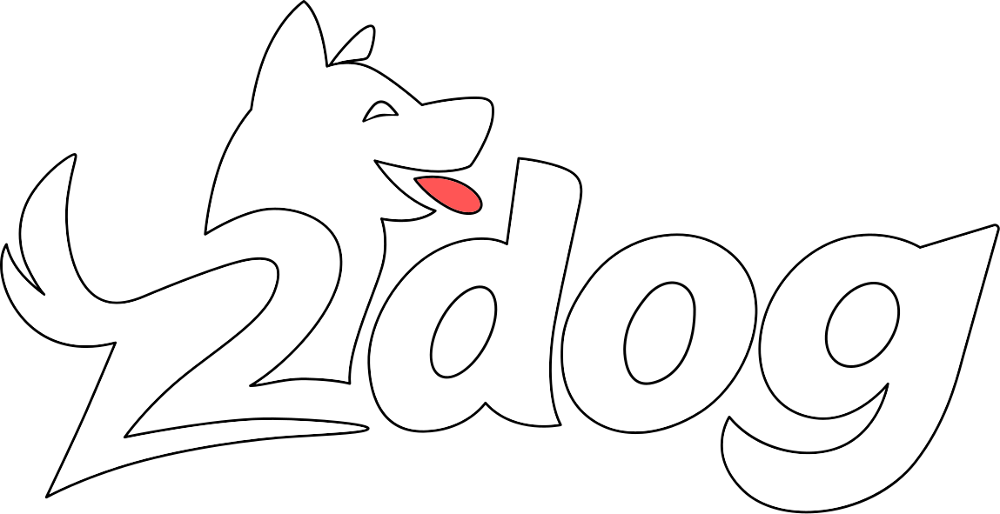

  

# 2dog fork of the Godot Engine

**This repository is not for end users.** For packages, getting started, and documentation,
visit [2dog.dev](https://2dog.dev) or the main [2dog repository](https://github.com/outfox/2dog).

This fork builds specific `libgodot` variants suited for embedding in .NET with 2dog.
Each `2dog-X.Y` branch tracks the corresponding Godot release line.

This repository can serve as a source for reference fixes in upstream Godot, but parts
of it are AI-maintained or prototyped (particularly experimental features), so we
maintain a separate fork.

Godot and this repository are [MIT licensed](LICENSE.txt).
